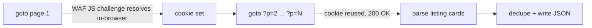

# Properstar Tunisia House Scraper

Scrapes live house listings (price, location, size, rooms, contact) from
[properstar.com](https://www.properstar.com/tunisia/buy/house) for Tunisia —
**despite the site sitting behind an Azure Web Application Firewall
JavaScript challenge** that blocks every plain HTTP client outright.

```json
{
  "url": "https://www.properstar.com/listing/116816252",
  "title": "Home for sale in Djerba Midoun, Tunisia",
  "location": "Djerba Midoun",
  "price": "$216,996",
  "size": "2153 sq ft",
  "rooms": "6 rooms",
  "bedrooms": "3 bed",
  "bathrooms": "2 bath",
  "house_maker_contact": "FRANTZ VALERIE"
}
```

More examples in [`sample_output.json`](sample_output.json) — a full run
collects 500+ unique listings.

## The problem: a 403 that won't go away

`curl`, `requests`, and Scrapy's default downloader all get an immediate
`403 Forbidden` from properstar.com, regardless of User-Agent or headers.
Inspecting the response body reveals why:

```html
<meta name="description" content="Azure WAF JS Challenge"/>
```

The site sits behind **Microsoft Azure's WAF JavaScript challenge** — it
serves a JS snippet that must execute in a real browser before the origin
will respond with actual content. No amount of header spoofing fixes that;
the client has to *run JavaScript*.

The natural fix would be `scrapy-playwright` (Scrapy + a real headless
browser). It wasn't enough: scrapy-playwright captures every request through
Playwright's `page.route()` interception so it can turn responses back into
Scrapy `Response` objects — and that interception itself was enough to break
the WAF challenge into an infinite redirect loop (verified: 11 navigations,
zero resolution, every time, regardless of timeout).

## The fix: drive the browser directly

[`scrape_properstar.py`](scrape_properstar.py) bypasses Scrapy's downloader
entirely and drives a single headless Chromium session with the
**Playwright API directly** — no request interception, nothing to detect:

1. Load page 1. The WAF challenge resolves transparently inside the page
   (Playwright executes the JS like any browser would); a cookie is set.
2. Reuse the **same browser context** for every paginated request
   (`?p=2`, `?p=3`, …) — the WAF cookie carries over, so every request after
   the first returns `200` immediately, no re-challenge.
3. Parse each page's listing cards, dedupe by listing URL, and stop early
   once a page contributes no new listings.



A secondary, **unused-by-default** Scrapy spider
([`properstar/spiders/house_price_spider.py`](properstar/spiders/house_price_spider.py))
is kept in the repo for the production-scale alternative: routing requests
through an anti-bot-aware proxy like [Zyte API](https://docs.zyte.com/zyte-api/get-started.html),
which solves the same challenge server-side. See [Alternative path](#alternative-scrapy--zyte-api) below.

## Stack

| Layer | Choice |
|---|---|
| Browser automation | [Playwright](https://playwright.dev/python/) (Chromium, headless) |
| Crawling framework (alt. path) | [Scrapy](https://scrapy.org/) + [scrapy-zyte-api](https://scrapy-zyte-api.readthedocs.io/) |
| Parsing | Playwright's own DOM query API (`query_selector_all`) + regex for structured fields |
| Env / deps | [uv](https://docs.astral.sh/uv/) |

## Quickstart

```powershell
uv sync
uv run playwright install chromium
uv run python scrape_properstar.py --max-pages 35 --output houses.json
```

Output: a JSON array of listings at the path you gave `--output`.

| Flag | Default | Description |
|---|---|---|
| `--max-pages` | `30` | Page cap (site currently lists ~575 houses / ~29 pages) |
| `--output` | `houses.json` | Output file path |
| `--headed` | off | Launch a visible browser window (useful for debugging) |

## Project layout

```
scrape_properstar.py          # working scraper — Playwright-driven, no API key needed
sample_output.json            # a handful of real records for reference
properstar/                   # Scrapy project (alternative path, see below)
  items.py                    # ProperstarItem schema
  settings.py                 # Scrapy settings + Zyte API wiring
  spiders/house_price_spider.py
scrapy.cfg
pyproject.toml / uv.lock
```

## Alternative: Scrapy + Zyte API

For a production-scale crawl (concurrency, retries, monitoring, no local
browser to maintain), the `properstar` Scrapy project routes requests
through [Zyte API](https://docs.zyte.com/zyte-api/get-started.html), which
solves anti-bot challenges like this one on their infrastructure:

```powershell
$env:ZYTE_API_KEY = "your_key_here"
uv run scrapy crawl properstar_houses -O houses.json
```

## Notes

- Respects `DOWNLOAD_DELAY` / one request in flight at a time — this is a
  portfolio/learning project, not a high-volume crawler.
- `houses.json` (the full scrape) isn't committed — it's regenerated by
  running the script. `sample_output.json` shows the shape of the data.
- Built as a debugging exercise after a first attempt (via an AI coding
  agent) silently failed against the WAF and returned nothing — the
  interesting part of this project is root-causing *why* a request gets
  blocked rather than just retrying with different headers.

## License

[MIT](LICENSE)
